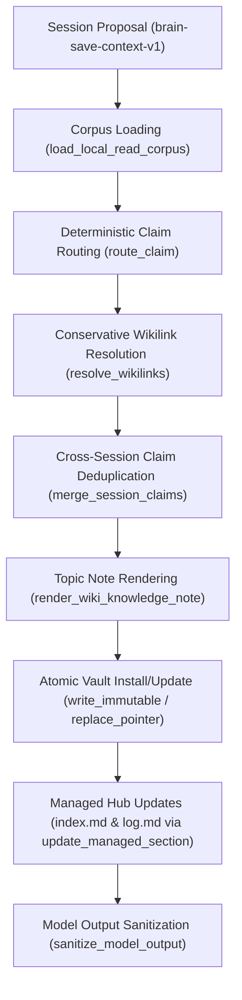

# Wiki Memory Integration Architecture (Track B / T05-T07)

Status: Specification and integration reference for `scripts/wiki_memory.py` and its verification suite `tests/test_wiki_integration.py`. This document defines the end-to-end ingestion pipeline, concurrency protocols, write-ahead logging, and security boundaries governing tool-managed knowledge in the canonical Obsidian vault.

---

## 1. Overview and Design Principles

The wiki memory integration layer connects the explicit, turn-based session capture pipeline (`brain-save-context-v1`) with durable, connected Obsidian knowledge notes. It maintains topic notes, manages navigation routes in `index.md`, and appends audit entries in `log.md` without requiring external daemons, watcher processes, database engines, graph processors, or remote model calls.

```
       [Session Capture Proposals]
        (brain-save-context-v1)
                   │
                   ▼
       ┌───────────────────────┐       [Approved Enrolled Manifest]
       │  scripts/wiki_memory  │ ◄──── (brain-managed-manifest-v1)
       └───────────┬───────────┘
                   │
        ┌──────────┴──────────┐
        ▼                     ▼
[Private Transactions]  [Canonical Obsidian Vault]
 • publish-*.lock        • projects/<slug>/<topic>.md
 • wiki-updates/         • permanent/engineering/<topic>.md
   ├─ journal.json       • index.md (<!-- brain-managed:start section="index-routes" -->)
   └─ receipt.json       • log.md   (<!-- brain-managed:start section="change-log" -->)
```

### Core Invariants

1. **Deterministic Content Addressing:** All note paths, note identifiers, and claim identifiers are derived deterministically from normalized slugs and normalized prose, eliminating naming collisions and arbitrary identifier drift across turns.
2. **Strict File Ownership & Disjoint Workspaces:** Machine writes target only approved enrolled topic files and explicitly delimited managed comment blocks. Manual notes and unmanaged bytes are protected by byte-for-byte pre/post checks.
3. **Fail-Closed Concurrency & Recovery:** All vault modifications are preceded by filesystem-level mutual exclusion locks and private immutable write-ahead journals (`brain-wiki-section-journal-v1`). Any interruption before or after pointer swap is cleanly recoverable.
4. **Hermetic Privacy Boundaries:** Personal, synthetic, and restricted classifications are strictly isolated. Canary tokens (`DENIED_CONTENT_CANARY`) in unapproved or personal files are guaranteed to never be read, linked, or emitted into model outputs.

---

## 2. End-to-End Ingestion Flow

The ingestion pipeline executes in distinct, sequential stages, ensuring that validation occurs before any mutation is attempted:



### 2.1 Stage 1: Proposal Intake & Validation

Session proposals adhere to the `brain-save-context-v1` schema. Each session entry supplies:
- `project_slug`: Target project directory slug (e.g., `"data-engine"`).
- `project_id`: 64-character hexadecimal project identifier.
- `session_reference`: Identifier for the originating session (e.g., `"session-turn-1"`).
- `role`: Role of the authoring agent (`"planner"`, `"implementer"`, `"reviewer"`, etc.).
- `date`: ISO-8601 UTC timestamp with required timezone offset (e.g., `"2026-11-06T10:00:00+00:00"`).
- `privacy`: Level of privacy (`"synthetic"` or `"personal"`).
- `claims`: Array of structured claims (up to 8 items).

### 2.2 Stage 2: Scope Resolution & Corpus Loading

`load_local_read_corpus()` inspects the enrolled manifest (`manifest_notes`) against the owner-approved `local_read_scope` (`prefixes` and `notes`):
- Notes outside approved prefixes or IDs are completely ignored.
- Notes with `privacy: "restricted"` are unconditionally excluded.
- Notes with `privacy: "personal"` are excluded unless `allow_personal=True` is explicitly authorized.
- Only notes passing the filter are opened from disk; on-disk file size and SHA-256 digest are strictly verified against the manifest before reading.
- Reparse points, junctions, and directory traversal attempts trigger immediate `REDIRECTED_VAULT_ROOT` or `REDIRECTED_WIKI_PATH` exceptions.

### 2.3 Stage 3: Claim Routing and Note Identity

`route_claim()` routes each claim based on its `kind` and `topic`:
- **Lessons (`kind == 'lesson'`):** Routed to `permanent/engineering/<topic-slug>.md` with note ID `deterministic_note_id('lesson', 'engineering', topic_slug)`.
- **Engineering Claims (`decision`, `work`, `test`, `blocker`, `next-action`, `review`):** Routed to `projects/<project-slug>/<topic-slug>.md` with note ID `deterministic_note_id('project', project_slug, topic_slug)`.
- **Claim ID Generation:** `deterministic_claim_id(topic_slug, claim_text)` computes `claim-<sha256[:16]>` over the normalized subject key and collapsed-whitespace lowercase prose.

### 2.4 Stage 4: Conservative Wikilink Resolution

`resolve_wikilinks()` resolves candidate link queries against the approved corpus:
- **Unambiguous Matching:** Matches against note ID, path stem, title, or aliases. A wikilink is emitted *only* if exactly one matching note exists in the enrolled corpus.
- **Section/Anchor Resolution:** If a query requests a `#heading`, the target note's parsed ATX headings are checked. If the heading does not exist, the link is skipped with reason `MISSING_HEADING`.
- **Ambiguity & Missing Targets:** If multiple notes match or zero notes match, the query is recorded in `skipped` (`AMBIGUOUS_MATCH` or `NO_MATCH`) without guessing or hallucinating links.
- **Wikilink Syntax:** All generated wikilinks use validated vault-relative paths: `[[path/to/target#Heading|Label]]` or `[[path/to/target#Heading]]`.

### 2.5 Stage 5: Cross-Session Claim Deduplication & History Management

`merge_session_claims()` consolidates claims within each topic note:
- **Identical Claims (Deduplication):** If an incoming claim matches an existing active claim on the same subject key with identical normalized text, the prose is not duplicated. Instead, the incoming session's provenance record (`session_reference`, `role`, `date`, `status`, `evidence`, `locator`) is appended to the claim's provenance list, and `updated` is advanced.
- **Superseding Claims:** If an incoming claim specifies `supersedes: [<claim_id>]`, and the listed IDs cover all currently active claims for that subject, earlier claims transition to `lifecycle: 'superseded'`, record `superseded_by: [<new_claim_id>]`, and are moved to the `## Historical & Superseded Claims` section.
- **Contradictory Claims (Quarantine):** If an incoming claim shares a subject key with existing active claims but does *not* explicitly supersede them, it is quarantined into `quarantined` under `## Unresolved Contradictions (Quarantined)`. The active knowledge remains pristine and uncorrupted.
- **Cross-Privacy Guard:** Attempts to merge claims across different privacy levels (e.g., merging a `personal` claim into a `synthetic` claim) raise `PRIVACY_BOUNDARY_MISMATCH`.

### 2.6 Stage 6: Topic Note Rendering & Vault Commitment

`render_wiki_knowledge_note()` generates a deterministic Markdown note:
- Standard YAML frontmatter (`schema_version: '1.0'`, `id`, `title`, `kind`, `review_state: 'policy-validated'`, `created`, `updated`, `privacy`, `external_processing`, `sources`).
- H1 title and automatic policy validation disclaimer.
- `## Active Knowledge`: List of active claims with provenance lines.
- `## Historical & Superseded Claims`: Chronological historical claims (if any).
- `## Connected Notes`: Unique path-qualified wikilinks (if any).
- `## Unresolved Contradictions (Quarantined)`: Quarantined claim IDs with conflict references (if any).

When writing to the vault:
- **New Note:** Installed using `write_immutable()` (temp file with `fsync`, atomic rename on Windows or hardlink on POSIX, refusing clobber).
- **Existing Note:** Target must be enrolled in `manifest_notes` matching current size and hash; updated using `replace_pointer()` (atomic `os.replace` via temp file).
- **Unmanaged File Protection:** If a target file exists on disk but is absent from `manifest_notes`, `UNMANAGED_TARGET_COLLISION` is raised, preventing adoption or modification of manual files.

### 2.7 Stage 7: Hub & Navigation Updates

`update_managed_section()` updates `index.md` and `log.md`:
- **`index.md`:** `render_managed_index_routes()` updates the Markdown navigation table inside `<!-- brain-managed:start section="index-routes" -->`.
- **`log.md`:** `render_managed_log_entries()` prepends/updates verified change entries (`timestamp`, `operation`, `note_links`, `locator`, `verification`) inside `<!-- brain-managed:start section="change-log" -->`.
- **Unmanaged Byte Preservation:** All bytes outside the marker tags (headers, metadata, custom documentation, footers) must remain byte-for-byte identical.

### 2.8 Stage 8: Model Output Sanitization

`sanitize_model_output()` produces the bounded return payload for the caller:
- Returns operation status (`SAVED`, `UPDATED`, `NO_CHANGE`), transaction ID, and numeric counts (`saved`, `updated`, `linked`, `skipped`, `quarantined`).
- Note bodies, full file paths, note titles, and link query text are stripped.
- Permitted links are only returned if `model_output_policy` explicitly enables them *and* target notes have `external_processing: true`.

---

## 3. Concurrency, Locks, and Write-Ahead Logging

Modifications to the shared vault follow a strict transaction and recovery protocol.

### 3.1 Publication Lock Protocol

Concurrency is managed through `publication_lock(private_root, vault_root)`:
- Lock file location: `private_root / 'locks' / ('publish-' + sha256(vault_root.casefold()) + '.lock')`.
- Acquisition uses OS-level exclusive creation: `os.open(path, os.O_CREAT | os.O_EXCL | os.O_WRONLY, 0o600)`.
- A unique UUID token is written and synced (`fsync`).
- Non-blocking: if the lockfile already exists, the context manager yields `False`, and `PUBLICATION_LOCK_BUSY` is raised immediately.
- Release: verified by reading the token before unlinking, ensuring an invocation never deletes another process's lock.

### 3.2 Journaled Write-Ahead Logging (WAL)

Every call to `update_managed_section()` executes a two-phase journaled transaction:

1. **Transaction ID Derivation:**
   ```python
   tx_seed = json_bytes({
       'vault': str(vault),
       'relative_path': relative_path,
       'section': section,
       'expected_preimage_sha256': expected_preimage_sha256,
       'new_section_body_sha256': sha256(new_section_body),
   })
   transaction_id = sha256(tx_seed)
   ```
2. **Transaction Workspace:** Stored in `private_root / 'wiki-updates' / transaction_id /`.
3. **Step 1: Write Journal:** Writes `journal.json` (`brain-wiki-section-journal-v1`) containing:
   - `transaction_id`, `relative_path`, `section`
   - `preimage_sha256` and `preimage_utf8` (exact text before update)
   - `intended_sha256` and `intended_utf8` (exact intended text)
4. **Step 2: Atomic Pointer Swap:** Calls `replace_pointer(target, intended_bytes)` via temporary file with `os.replace`.
5. **Step 3: Verification:** Reads back target file from disk and verifies `sha256(target_bytes) == intended_sha256`.
6. **Step 4: Write Receipt:** Writes `receipt.json` (`brain-wiki-section-receipt-v1`) with `status: 'UPDATED'`.

### 3.3 Interruption Recovery State Machine

If an execution crashes or is killed midway, the next invocation detects the journal and recovers deterministically:

| Target Disk State | Journal Present? | Receipt Present? | Action Taken | Returned Status / Stage |
|---|---|---|---|---|
| `disk == preimage` | Yes | No | Re-apply `replace_pointer` with `intended_bytes`, verify, write receipt | `RECOVERED` (`APPLIED_FROM_PREIMAGE`) |
| `disk == intended` | Yes | No | Pointer swap already succeeded; write receipt | `RECOVERED` (`FINALIZED_RECEIPT`) |
| `disk == intended` | Yes | Yes | Transaction already fully committed; no disk write needed | `NO_CHANGE` |
| `disk != preimage` and `disk != intended` | Yes | Any | External owner edit collided with pending update | Raise `LATER_EDIT_CONFLICT` (preserves owner edits) |
| `disk != preimage` | No | No | Target modified since preimage hash was calculated | Raise `STALE_PREIMAGE_HASH` |

### 3.4 Managed Preimage Restoration

`restore_managed_preimage(private_dir, vault_dir, transaction_id)` permits safe rollback:
- Verifies that target on disk matches `intended_sha256`.
- Restores `preimage_utf8` atomically via `replace_pointer`.
- Refuses restoration with `LATER_EDIT_CONFLICT` if any third-party modification occurred after the update.

---

## 4. Security Boundaries and Privacy Isolation

The wiki integration engine enforces multi-layered defense-in-depth across storage, process, and model context.

### 4.1 Privacy Tier Partitioning

| Tier | Characteristics | Ingestion Policy | Model Context Exposure |
|---|---|---|---|
| `synthetic` | Non-confidential test/engineering knowledge | Ingested by default (`allow_personal=False`) | Summary metadata permitted; titles/paths only if authorized |
| `personal` | Sensitive private notes/context | Blocked unless `allow_personal=True` explicitly passed | Never exposed without specific authorization |
| `restricted` | Highly sensitive material (credentials, keys) | Strictly rejected from corpus loading and linking | Completely excluded; zero access |

### 4.2 Protection Against Canary Leaks (`DENIED_CONTENT_CANARY`)

To ensure that confidential information cannot be exfiltrated through wikilinks, headers, or model responses, tests verify synthetic canaries:
1. **Unselected Notes:** Files in the vault that are not enrolled in `manifest_notes` are never opened, never stat-checked, and never linked.
2. **Unapproved Scopes:** Notes outside `local_read_scope` are filtered out in memory before any filesystem read.
3. **Query Resolution Blindness:** Queries attempting to link to personal or restricted titles, paths, or aliases fail with `NO_MATCH`.
4. **Output Redaction:** `sanitize_model_output()` strips prose, note contents, link queries, and denied titles from return values.

### 4.3 Reparse Point and Path Traversal Defenses

- All paths are validated via `validate_wiki_relpath()`: POSIX relative, no backslashes (`\`), no traversal (`..`), no Windows reserved device names (`CON`, `PRN`, `AUX`, `NUL`, `COM1-9`, `LPT1-9`), and maximum length 512 bytes.
- `_check_no_reparse_or_escape()` inspects every path ancestor using `os.lstat()`:
  - Reparse tags (`st.st_reparse_tag & 0x20000000`), junctions, and symlinks are rejected with `REDIRECTED_WIKI_PATH`.
  - Resolved target paths must remain strictly inside `vault_root.resolve()` (`is_relative_to()`).

---

## 5. Verification and Integration Test Coverage

The integration test suite in `tests/test_wiki_integration.py` verifies all integration behaviors end-to-end:

1. **`test_01_multiturn_cross_session_mixed_claims_ingestion`:**
   - Turn 1: Ingestion of `decision`, `work`, `lesson`, and `blocker` claims from Session 1 (Planner). Verifies creation of topic notes under `projects/` and `permanent/engineering/`, path-qualified wikilink creation, and initial updates to `index.md` routes and `log.md` entries.
   - Turn 2: Ingestion from Session 2 (Implementer). Verifies:
     - Deduplication: identical normalized claim retains single prose block while appending multi-session provenance.
     - Superseding: blocker claim superseded and moved to `## Historical & Superseded Claims`.
     - Contradiction Quarantine: conflicting claim on active topic safely quarantined under `## Unresolved Contradictions (Quarantined)`.
     - Lesson update: lesson topic note updated with new superseded claim.
     - Hub updates: `index.md` routes table and `log.md` change log updated cleanly.
2. **`test_02_preservation_of_unmanaged_bytes_in_index_and_log`:**
   - Verifies exact byte-for-byte preservation of unmanaged frontmatter, Markdown headings, blockquotes, code fences, and footers across section updates in `index.md` and `log.md`.
3. **`test_03_recoverable_recovery_after_simulated_interruption`:**
   - Tests write-ahead log recovery across 5 distinct stages:
     - Interruption before pointer swap (`recovery_stage: 'APPLIED_FROM_PREIMAGE'`).
     - Interruption after pointer swap before receipt write (`recovery_stage: 'FINALIZED_RECEIPT'`).
     - Idempotent replay with existing receipt (`status: 'NO_CHANGE'`).
     - Preimage rollback via `restore_managed_preimage` (`status: 'RESTORED'`).
     - Intervening edit conflict detection on restore (`LATER_EDIT_CONFLICT`).
4. **`test_04_strict_canary_isolation_and_privacy_boundaries`:**
   - Places canary strings in unmanaged vault notes, personal notes, and restricted notes.
   - Verifies link queries targeting canaries are skipped (`NO_MATCH`).
   - Asserts zero occurrences of any canary token across all created notes, hub documents, log entries, and serialized model output dictionaries.
5. **`test_05_concurrency_lock_and_conflict_resolution`:**
   - Verifies publication lock mutual exclusion (`PUBLICATION_LOCK_BUSY`).
   - Verifies refusal of stale preimage hashes (`STALE_PREIMAGE_HASH`).
   - Verifies refusal of journaled updates when target on disk experienced an intervening external edit (`LATER_EDIT_CONFLICT`).
